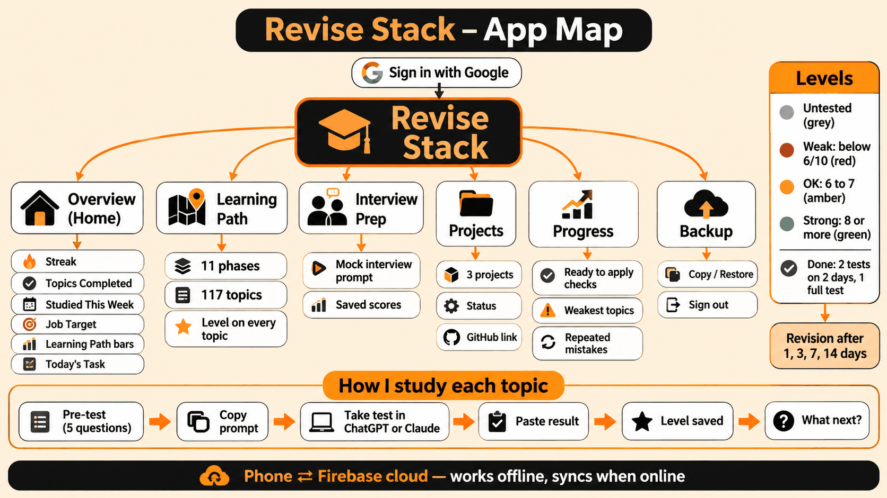

<p align="center"></p>

# Revise Stack

An installable revision tracker for a Java Full Stack syllabus (117 topics, 3 projects).
You take the tests in ChatGPT or Claude. Revise Stack plans your day, records your level and keeps your progress safe.

- Runs in the browser and installs on your phone like an app. Works offline.
- Progress is saved in **Firebase** (Google sign-in) and also kept on the device, so you can study without internet and it syncs later.
- No server of your own and no build step. Plain HTML, CSS and JavaScript.
- Orange and black theme taken from the logo, with light and dark mode that follow the phone setting.

## App map

<p align="center"></p>

## How it works

1. **Overview** (Today) shows one task: a due revision first, then a new topic.
2. **Pre-test first.** A topic you have never tested starts with a **Pre-test**: 5 questions, no teaching, to see what you already know. Copy the test prompt, paste it into an AI chat and take the test. (You can also choose **Learn first** or a **Full test** under Mode. On the pre-test card, **I don't know this topic** skips the questions and saves a 0/5 pre-test (Weak, goes to Learn first, not counted in revision); Undo removes it. A pre-test is allowed once per topic, only before any other test (Undo it to take it again). There is no Quick test: old Quick results are converted to pre-tests on load.)
   - **A pre-test is only a starting check.** It is not counted in the level, in Done, in your progress numbers or in revision. It never makes a topic due. You can pre-test the whole syllabus in one go and the revision list stays empty.
   - What it does: Weak and OK pre-tests move those topics to the front of your new topics (weakest first), and they appear in **Progress > Learn first** with a "Pre-test" badge. Strong pre-tests go to the back and get a Full test to confirm.
   - After you learn a topic, your first **Full test** (10 questions) is the first real test. That is when the level is set and the revision schedule starts.
3. **Paste the AI reply** back. The app reads the `RESULT_START ... RESULT_END` block and saves the score. A manual score form is the backup.
4. The app works out the level from the score of real tests (not pre-tests) and tells you **what next**:
   - **Weak** (below 6/10): choose Learn first, study the weak points, then test again.
   - **OK** (6 to 7): revise the weak points, test again on the due date.
   - **Strong** (8 or more): after a 5-question test, take a Full test to reach Done.
   - **Done:** 2 tests on 2 different days, both Strong, at least one a Full test (10 questions).
5. Revisions (standard spaced revision) come back 1, 3, 7 and 14 days after the first real test of a passing run. A result under 60% resets the schedule.
6. Streak: any saved test counts. One missed day per week is forgiven.

## Pages

| Page | What it has |
|---|---|
| Overview | Greeting, goal banner, four numbers (streak, topics completed, studied this week, job target), learning path, projects, today's task (buttons: Open topic, Short on time?, Another topic) and the test steps |
| Learning Path | All phases and topics with levels, filters and each topic's history |
| Interview Prep | Mock interview prompt on your weakest topics and your saved mock scores |
| Projects | Status, repository link and note for each project. **Add a project** (name, stack, phases it needs) for your own; you can remove those later |
| Progress | Core progress, apply-readiness checks, Learn first list (from pre-tests), weakest topics, repeated mistakes, progress summary to paste into an AI |
| Analysis | Pick a phase. Headline numbers, plain-words insights, a donut of how much is completed (Done, Strong, OK, Weak, Not started), pace to your apply-by date, phase bars, tests per week, average score per week, test mix donut. Each chart has a table view. Pre-tests count as activity only, never as a score |
| Profile | Opens from your name at the bottom of the sidebar (or the person icon on a phone). Shows your details; click Edit to change them. Name, target role, city, apply-by date, study hours per day (saved with your data, so Firebase and backups carry them). Account: Upload now, Backup link, Sign out |
| What's new | A card on the Overview after each update (until you tap Got it) and the full list on the Profile page. The text lives in `js/data/changelog.js`: add an entry and raise `APP_VERSION` for every update |
| Importance and prerequisites | Each topic in `data/syllabus/*.json` has `importance` (1 to 5, shown as stars; 5 = must know), optional `needs` (topic ids to finish first) and an optional `before` note. The topic page shows a **Before this topic** card with a ready check, the Learning Path has a 5★ Must know filter, and the note plus your level on the prerequisites go into the copied prompt as background only (no extra test questions) |
| Backup | Sign-in status, copy and restore as text, install help |

**Upload now** (cloud button in the sidebar, in the phone top bar and on the Backup page) sends this device's data to Firebase straight away and shows a message with the result. It replaces the online copy with this device's data, and it refuses if this device has no results while the online copy has some. Sign in is one button ("Continue with Google"). Sign out is the arrow button next to your name in the sidebar, or the Sign out button on the Profile page (the phone top bar has the Analysis and Profile icons). It uploads unsent changes first, and if that fails it keeps you signed in so nothing is lost. After signing out, the saved copy on that device is cleared, so a shared phone shows nothing to the next person.

On a wide screen the pages sit next to a left sidebar. On a phone the sidebar becomes a bottom bar.
Pages fade in, bars fill up and cards lift on hover (`css/motion.css`). All motion turns off when the phone is set to reduce motion.
The levels, the 70% thresholds and the study order are suggestions, not facts. They live in `js/core/config.js`.

## Online storage (Firebase)

Progress is saved in Firestore, one document per person (`users/<your id>`), after you sign in with Google.
The device keeps a copy so the app opens fast and works offline.

- **Offline:** changes are kept on the device and marked as unsent, even if you close the app.
- **Back online:** unsent changes are merged with the cloud copy (every test from both is kept) and uploaded.
- **New device:** sign in and your progress appears. The cloud copy wins unless that device has unsent changes.
- If a test is deleted offline, the merge can bring it back. Delete it again once you are online.
- Until `js/cloud/config.js` has your Firebase values, the app runs in local-only mode.
- Speed: the sign-in button appears as soon as the small login code loads. The Firestore code (the lite build, since the app only reads and writes one document) loads in the background. A new device shows "Loading your progress…" instead of an empty dashboard.

Set it up once:

1. Firebase console: create a project, add a Web app, copy `apiKey`, `authDomain`, `projectId` and `appId` into `js/cloud/config.js`. These are not secrets. Also set `FIREBASE_DATABASE` to the database ID shown in Firestore: `(default)` is the standard name; if the console shows `default` without brackets, use `default`.
2. Authentication: enable the **Google** provider. Under Settings > Authorized domains add your site address (for example `nagaraj-s-patil.github.io`).
3. Firestore Database: create it in Production mode, open the Rules tab, paste `firestore.rules` and publish. Without these rules your data is not protected.
4. Open the app and sign in with Google. Progress already saved in that browser is uploaded the first time.

## Install on your phone

Open the site's web address on your phone and sign in once.

- **Android (Chrome):** tap **Install app** on the Overview card, or the browser menu, then **Install app**.
- **iPhone (Safari):** tap Share, then **Add to Home Screen**.

Use one web address only. Copy a backup from the **Backup** page now and then as an extra safety copy.

**Updates:** the app checks for a new version every time it opens and reloads itself once when it finds one. The home-screen icon is the exception: a phone saves it at install time, so after a logo change remove the app and add it again.

## Run it on your computer

Needs Node 18 or newer. There is nothing to install and no build step.

```
npm start      # http://localhost:8080
npm test       # unit tests and file checks
```

The app uses ES modules and a service worker, so it must be served. Opening `index.html` as a file will not work.

## Publish it (GitHub Pages)

Settings, Pages, **Deploy from a branch**, branch `main`, folder `/ (root)`. The site is then at `https://<user>.github.io/Revise_Stack/`.

After changing any app file, run `npm run precache` and commit `sw.js` too. It rewrites the file list and version that phones use to update their offline copy. `npm test` fails if you forget.

## Project structure

```
index.html              page shell
manifest.webmanifest    install details (name, icons, colours)
sw.js                   offline support (file list generated by npm run precache)
firestore.rules         Firestore security rules (paste into the Firebase console)
assets/
  brand/                full logo
  icons/                app icons (192, 512, maskable, Apple, favicons, logo mark)
  fonts/                self-hosted fonts (Plus Jakarta Sans, JetBrains Mono) and licences
css/
  fonts.css  tokens.css  base.css  layout.css  components.css  pages.css  dashboard.css  signin.css  motion.css
data/
  syllabus/             index.json and one JSON file per phase
  projects.json         the portfolio projects
docs/syllabus.md        the syllabus as written
docs/app-map.png        the picture of the whole app shown at the top of this file
js/
  app.js  shell.js  pwa.js  boot-guard.js
  core/                 pure logic, no page code: levels, parser, prompts, plan, streak,
                        progress, summary, backup, mistakes, mock, spot check, profile, analysis, config
  cloud/                Firebase: config.js (your project values), sync.js (sign-in and sync)
  data/                 loads and checks the syllabus files
  state/                saved data (store), loaded syllabus (context), screen state (session)
  ui/                   dom helpers, router, messages, draft saving
  ui/components/        sidebar and tabs, header, dashboard pieces, icons, study steps, install card
  pages/                today (Overview), syllabus (Learning Path), topic, interview, projects, analysis, profile,
                        progress, backup, signin
test/                   unit tests by area, file checks, helpers
tools/                  serve, update-precache, generate-syllabus, make-icons (rebuilds every icon from assets/brand/logo-source.png)
```

## Changing the syllabus

Edit `docs/syllabus.md`, run `npm run syllabus`, then `npm run precache`.
Topic ids are permanent: never rename one, or that topic's history disconnects. `npm test` checks the ids from the first version still exist.

## Known gaps

- Results for a topic id that is removed from the syllabus stay in your data and backup but are not shown on screen.
- Reminders are not possible from a web page. Set a daily alarm on your phone.
- Sync was tested with a simulated Firebase. Check it on your own phone after the first sign-in.
- A test deleted while offline can come back after the merge. Delete it again once you are online.
- Sign-in uses a Google popup. Some in-app browsers block popups: open the site in Chrome or Safari.
