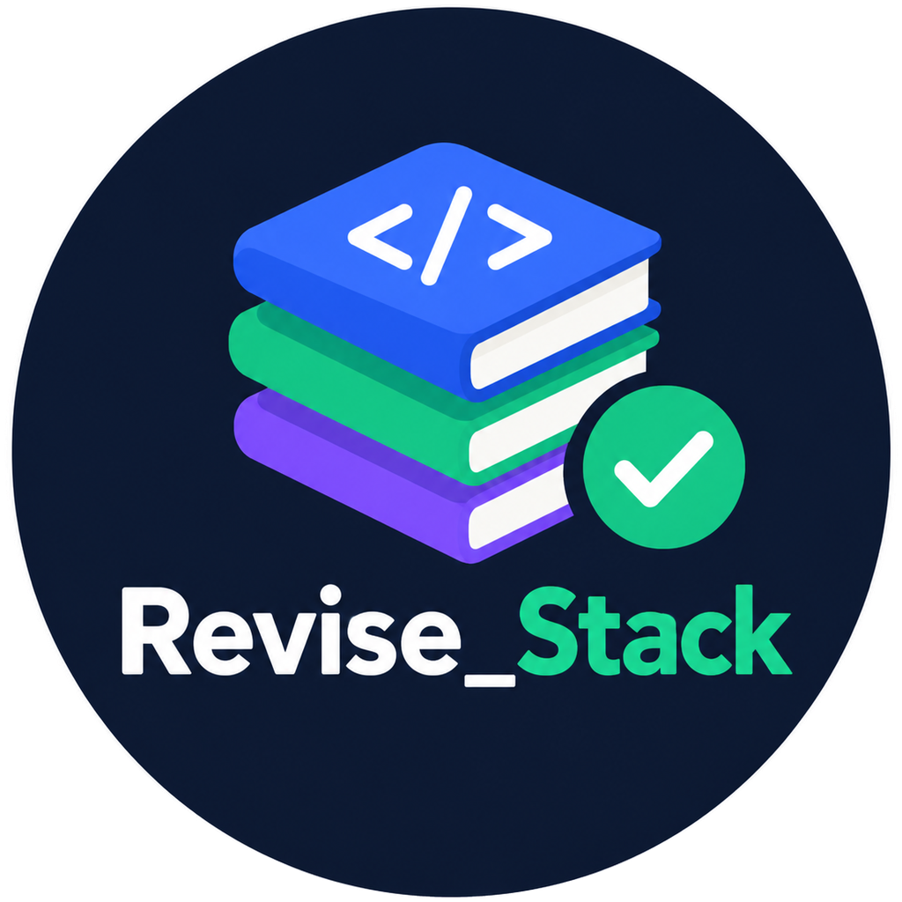

<p align="center"></p>

# Revise Stack

An installable revision tracker for a Java Full Stack syllabus (117 topics, 3 projects).
It runs in the browser, saves progress on your phone (localStorage) and works offline. There is no backend and no login.

You take the tests in ChatGPT or Claude. Revise Stack plans your day and records your level.

## How it works

1. **Today** shows one task: a due revision first, then a new topic.
2. **Copy test prompt** (Learn, Quick or Full), paste it into an AI chat and take the test.
3. **Paste the AI reply** back. The app reads the `RESULT_START ... RESULT_END` block and saves the score. A manual score form is the backup.
4. The app works out the level from the score:
   - Weak: below 6/10 · OK: 6 to 7 · Strong: 8 or more
   - **Done:** 2 tests on 2 different days, both Strong, at least one a Full test (10 questions)
5. Revisions come back 1, 3, 7 and 14 days after the first test of a passing run. A result under 60% resets the schedule.
6. Streak: any saved test counts. One missed day per week is forgiven.

Other pages: Syllabus, Projects, Progress (readiness checks, weakest topics, repeated mistakes, mock interview, progress summary for the AI) and Backup (copy and restore as text, install help).

The levels, the 70% thresholds and the study order are suggestions, not facts. They live in `js/core/config.js`.

## Install on your phone

Open the site's web address on your phone.

- **Android (Chrome):** tap **Install app** on the Today card, or the browser menu, then **Install app**.
- **iPhone (Safari):** tap Share, then **Add to Home Screen**.

Progress is stored per browser and per web address. Copy a backup from the **Backup** page now and then, and again before changing address or phone.

## Run it on your computer

Needs Node 18 or newer. There is nothing to install and no build step.

```
npm start      # http://localhost:8080
npm test       # unit tests and file checks
```

The app uses ES modules and a service worker, so it must be served. Opening `index.html` as a file will not work.

## Publish it (GitHub Pages)

Settings, Pages, **Deploy from a branch**, branch `main`, folder `/ (root)`. The site is then at `https://<user>.github.io/Revise_Stack/`.

After changing any app file, run `npm run precache` and commit `sw.js` too. It rewrites the file list and version that phones use to update their offline copy. `npm test` fails if you forget.

## Project structure

```
index.html              page shell
manifest.webmanifest    install details (name, icons, colours)
sw.js                   offline support (file list generated by npm run precache)
assets/
  brand/                full logo
  icons/                app icons (192, 512, maskable, Apple, favicons, header mark)
  fonts/                self-hosted fonts and their licences
css/
  fonts.css  tokens.css  base.css  layout.css  components.css  pages.css
data/
  syllabus/             index.json and one JSON file per phase
  projects.json         the portfolio projects
docs/syllabus.md        the syllabus as written
js/
  app.js  shell.js  pwa.js  boot-guard.js
  core/                 pure logic, no page code: levels, parser, prompts, plan, streak,
                        progress, summary, backup, mistakes, mock, spot check, config
  data/                 loads and checks the syllabus files
  state/                saved data (store), loaded syllabus (context), screen state (session)
  ui/                   dom helpers, router, messages, draft saving, shared components
  pages/                today, syllabus, topic, projects, progress, backup
test/                   unit tests by area, file checks, helpers
tools/                  serve, update-precache, generate-syllabus, make-icons
```

## Changing the syllabus

Edit `docs/syllabus.md`, run `npm run syllabus`, then `npm run precache`.
Topic ids are permanent: never rename one, or that topic's history disconnects. `npm test` checks the ids from the first version still exist.

## Known gaps

- Results for a topic id that is removed from the syllabus stay in your data and backup but are not shown on screen.
- Desktop uses one centred column with the bottom tabs.
- Reminders are not possible from a web page. Set a daily alarm on your phone.
